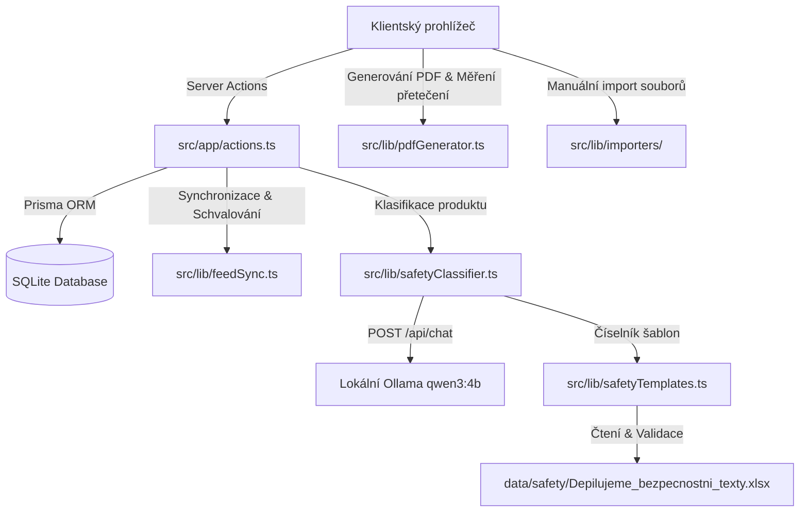

# Kompletní technická dokumentace – Štítkovač (Generátor štítků)

Tento dokument slouží jako komplexní technický průvodce architekturou, databázovým schématem, synchronizací Shoptet feedu, lokálním AI asistentem pro bezpečnostní texty, generátorem PDF a rozšiřováním aplikace **Štítkovač**.

---

## 1. Celkový přehled a adresářová struktura

Aplikace **Štítkovač** je postavena jako fullstack webová aplikace v Next.js 16 (App Router) s React 19, SQLite databází (Prisma ORM) a lokální integrací na Ollama LLM. Vektorové generování PDF archů probíhá na straně klienta pomocí `pdf-lib` a `@pdf-lib/fontkit`.



### Mapa adresářů projektu:

*   **`data/safety/`**
    *   `Depilujeme_bezpecnostni_texty.xlsx`: Jediný ručně udržovaný zdroj bezpečnostních textů, kódů kategorií, režimů a pokynů pro AI asistenta (listy `Šablony` a `Použití`).
*   **`prisma/`**
    *   `schema.prisma`: Definuje databázové schéma SQLite a Prisma Clienta.
    *   `dev.db`: Lokální soubor SQLite databáze (v `.gitignore`, nikdy se nenahrává do veřejného repozitáře).
*   **`public/fonts/`**
    *   Obsahuje TrueType fonty `Roboto-Regular.ttf` a `Roboto-Bold.ttf` pro korektní vykreslení české diakritiky v PDF.
*   **`src/app/`**
    *   `actions.ts`: Veškeré Server Actions (správa produktů, analýza a ukládání importů, AI návrhy bezpečnostních textů, synchronizace Shoptet feedu, správa šablon, uživatelů a logů).
    *   `page.tsx`: Dashboard (statistika katalogu, zdraví dat, historie tisků).
    *   `import/`: Stránka importu kombinující **Automatický Shoptet feed & Schvalování** (`FeedImportTab.tsx`) a **Manuální import ze souboru CSV / XLSX** (`ImportClient.tsx`).
    *   `products/`: Katalog produktů (`ProductsClient.tsx`) s vyhledáváním, filtry kvality dat, editací popisu (`description`) a integrovaným AI asistentem pro výběr bezpečnostního textu.
    *   `print/`: Tisková fronta (`page.tsx`) s volbou počáteční pozice (1–21), detekcí přetečení bezpečnostního textu a exportem do PDF.
    *   `templates/`: Editor šablon etiket (`page.tsx`) s kalibrací rozměrů a okrajů v milimetrech.
    *   `settings/`: Nastavení pravidel kontaktů (`ContactRule`), správa uživatelů a zálohování databáze / export katalogu.
    *   `logs/`: Auditní historie aktivit (`page.tsx`).
    *   `api/cron/sync-feed/route.ts`: Endpoint pro automatické spouštění synchronizace feedu přes cron/webhook.
    *   `api/backup/db/route.ts` & `api/backup/export/route.ts`: Stažení binární kopie SQLite databáze a kompletního XLSX exportu katalogu (včetně pole `Popis`).
*   **`src/lib/`**
    *   `db.ts`: Singleton instance Prisma Clienta.
    *   `safetyTemplates.ts`: Načítání, validace a mtime-caching Excel číselníku `data/safety/Depilujeme_bezpecnostni_texty.xlsx`.
    *   `safetyClassifier.ts`: Čištění HTML popisů (`stripHtmlToPlainText`), sestavení systémového promptu a komunikace s lokální Ollamou (`classifyProductSafety`).
    *   `feedSync.ts`: Logika synchronizace Shoptet feedu, detekce anomálií a správa schvalovací fronty (`PendingProductApproval`).
    *   `pdfGenerator.ts`: Vektorové vykreslování A4 archů etiket a výpočet přetečení textu (`detectSafetyTextOverflows`, `measureSingleLabelOverflow`).
    *   `importers/`: `CsvImporter.ts`, `XlsxImporter.ts`, `ShoptetFeedParser.ts`, `ProductImporter.ts`.

---

## 2. Nastavení prostředí a bezpečnost (`.env`)

V kořenovém adresáři se používá soubor `.env` (vzor v `.env.example`):

```env
DATABASE_URL="file:./dev.db"

# Výchozí přihlašovací údaje administrátora
BASIC_AUTH_USER=admin
BASIC_AUTH_PASSWORD=vaše_heslo
SESSION_SECRET=vas_tajny_session_klic

# Volitelné výchozí URL pro Shoptet Live Feed (XLS/XLSX/XML)
SHOPTET_FEED_URL="https://www.vas-eshop.cz/export/products.xls?patternId=..."

# Lokální AI Asistent (Ollama) – výhradně serverová konfigurace bez prefixu NEXT_PUBLIC
OLLAMA_BASE_URL="http://127.0.0.1:11434"
OLLAMA_MODEL="qwen3:4b"
```

> **Bezpečnostní upozornění pro veřejné nasazení:**
> Přihlašování využívá HTTP-only cookie `auth_session`, kterou kontroluje middleware v `src/proxy.ts` a na serveru funkce `requireAuthenticatedSession()` v `src/app/actions.ts`. Protože hodnota cookie v lokální verzi není kryptograficky podepsána pomocí HMAC, je toto řešení určeno pro lokální či interní provoz; před případným vystavením aplikace do veřejného internetu je vhodné doplnit kryptografický podpis session tokenu (např. HMAC-SHA256 / JWT).

---

## 3. Databázové schéma (Prisma)

1.  **`Product`**: Katalogová položka (`id`, `sku` unique, `name`, `description` nullable, `brand`, `price`, `safetyText`, `contactText`, `ean`, `note`, `createdAt`, `updatedAt`).
2.  **`PendingProductApproval`**: Položka čekající na schválení ze Shoptet feedu (`sku`, `name`, `description`, `brand`, `price`, `ean`, `safetyText`, `contactText`, `note`, `oldData` JSON, `changes` JSON, `warningType`, `warningMessage`, `status`).
3.  **`FeedConfig`**: Konfigurace automatické synchronizace (`url`, `autoApplySafe`, `priceThresholdPercent`, `checkEanValidity`, `cronSecret`, `lastSyncAt`, `syncStatus`, `syncMessage`).
4.  **`SyncLog`**: Historie běhů synchronizace feedu (`status`, `totalFetched`, `autoCreated`, `autoUpdated`, `pendingReview`, `unchanged`, `durationMs`).
5.  **`LabelTemplate`**: Tisková šablona archu (`name`, `fieldsConfig` JSON, `fontConfig` JSON, `layoutConfig` JSON, `sortOrder`, `isDefault`).
6.  **`ContactRule`**: Značková pravidla pro automatické doplňování distributora a výchozího bezpečnostního textu podle značky (`brandPattern`, `companyName`, `ico`, `address`, `website`, `safetyText`, `isDefault`).
7.  **`PrintJob`**: Historie vytištěných archů (`products` JSON, `startPosition`).
8.  **`User` & `ActivityLog`**: Uživatelské účty s PBKDF2 hashem hesla a auditní záznamy akcí.

---

## 4. Lokální AI Asistent pro bezpečnostní texty

### 4.1. Cesta jednoho požadavku od formuláře až k etiketě
1.  **Formulář produktu (`src/app/products/ProductsClient.tsx`):** Uživatel otevře existující nebo nový produkt, případně upraví název či popis a klikne na **„Navrhnout bezpečnostní text“** (produkt není nutné nejprve ukládat).
2.  **Server Action (`suggestProductSafetyTextAction` v `src/app/actions.ts`):** Ověří přihlášení uživatele na serveru (`requireAuthenticatedSession`) a předá aktuálně rozepsaný název a popis do `classifyProductSafety`.
3.  **Očištění vstupu a načtení číselníku (`src/lib/safetyClassifier.ts`, `src/lib/safetyTemplates.ts`):**
    *   `stripHtmlToPlainText()` odstraní z popisu případné `<script>`, `<style>`, e-shopové widgety a HTML značky a omezí délku vstupu.
    *   `loadSafetyTemplates()` načte a zvaliduje `data/safety/Depilujeme_bezpecnostni_texty.xlsx` (kontroluje povinné sloupce, duplicitní/prázdné kódy, platné režimy a přítomnost kódu `NEURCENO`).
4.  **Volání lokální Ollamy (`POST http://127.0.0.1:11434/api/chat`):**
    *   Server odešle požadavek s `stream: false`, `think: false`, `temperature: 0` a JSON schématem (`format`), které omezuje vlastnost `code` výhradně na výčet (`enum`) povolených kódů z Excelu.
    *   Modelu se posílají pouze kódy, oblasti, typy výrobků a vodítka – nikoliv celá znění bezpečnostních textů ani URL adresy.
5.  **Spárování s číselníkem a zobrazení v UI:**
    *   Server ověří vrácený kód proti mapě šablon z Excelu (při neznámém či neplatném kódu použije `NEURCENO`).
    *   V modálu produktu se zobrazí karta návrhu s typem výrobku, režimem, pokynem *Co zkontrolovat*, porovnáním se stávajícím textem a možností **změnit kategorii ručně** z rozbalovacího seznamu.
6.  **Vložení a tisk (`src/lib/pdfGenerator.ts`):**
    *   Po kliknutí na **„Použít návrh“** se text přenese do pole formuláře (kde jej lze dále upravit) a teprve tlačítkem **„Uložit změny“** se uloží do databáze.
    *   Při tisku na `/print` zkontroluje `detectSafetyTextOverflows()`, zda se celý bezpečnostní text vejde do zvolené šablony, a vykreslí jej písmem Roboto do PDF.

### 4.2. Jak promítnout změnu v Excelu (`Depilujeme_bezpecnostni_texty.xlsx`) do aplikace
Soubor `data/safety/Depilujeme_bezpecnostni_texty.xlsx` je jediným ručně udržovaným zdrojem kategorií a bezpečnostních textů:
1.  Otevřete `data/safety/Depilujeme_bezpecnostni_texty.xlsx` v Excelu, upravte texty nebo přidejte nový řádek na list `Šablony` (dodržte platný `Režim`: *Návrh ke schválení*, *Ověřit konkrétní výrobek*, *Ruční posouzení* nebo *Přeskočit*) a soubor uložte.
2.  Modul `src/lib/safetyTemplates.ts` sleduje čas poslední úpravy souboru (`fs.statSync(path).mtimeMs`). **Za běhu vývojového (`npm run dev`) i produkčního serveru (`npm start`) se změna po uložení Excelu projeví okamžitě při dalším kliknutí na „Navrhnout bezpečnostní text“ bez nutnosti přebudování aplikace.**
3.  Pro ověření, že upravený Excel neobsahuje překlep v názvu sloupce, duplicitní kód nebo neznámý režim, spusťte:
    ```bash
    npm test
    ```

---

## 5. Synchronizace Shoptet Feedu a Ochrana Souběhu

*   **Čištění HTML a e-shopových widgetů (`ShoptetFeedParser.ts`):** Při stahování živého Shoptet feedu parser odstraní parametr `stripTags=1` (který na straně Shoptetu ponechával vnitřek `<script>` tagů v textu) a pomocí `stripHtmlToPlainText()` čistě odstraní `<style>`, `<script>` i interaktivní widget *Průvodce procedurou* (`#lcp-o`).
*   **Detekce změn (`feedSync.ts`):** Samotné doplnění či změna popisu (`description`) se u bezproblémových položek propíše automaticky. Do schvalovací fronty (`PendingProductApproval`) putují položky s cenovým skokem nad povolený práh, výraznou změnou názvu nebo neplatným EANem.
*   **Ochrana bezpečnostního textu při schvalování:** Když je položka ve frontě schvalována později (`approvePendingProduct` / `approveAllPendingProducts`), porovná se aktuální `product.safetyText` v databázi se snapshotem `oldData.safetyText` z doby vzniku čekající položky. Pokud uživatel mezitím v katalogu bezpečnostní text ručně vyplnil nebo změnil, schválení položky z fronty tento novější ruční text **zachová a nepřepíše**.

---

## 6. Matematika PDF a Detekce Přetečení (`src/lib/pdfGenerator.ts`)

*   **Přepočet jednotek:** $\text{body (pt)} = \text{milimetry (mm)} \times \frac{72}{25.4} \approx \text{mm} \times 2.83464567$.
*   **Kontrola přetečení (`measureSingleLabelOverflow` & `detectSafetyTextOverflows`):**
    Před exportem PDF na stránce `/print` změří generátor skutečné zalomení řádků pomocí metrik vloženého písma `Roboto-Regular.ttf` / `Roboto-Bold.ttf` (`font.widthOfTextAtSize`). Pokud součet výšek vykreslených bloků překročí dostupnou výšku etikety (nebo poloviny etikety v duálním režimu), zobrazí aplikace před tiskem varovný banner se seznamem konkrétních SKU, počtem skrytých řádků a tlačítkem pro přechod do nastavení šablony.
