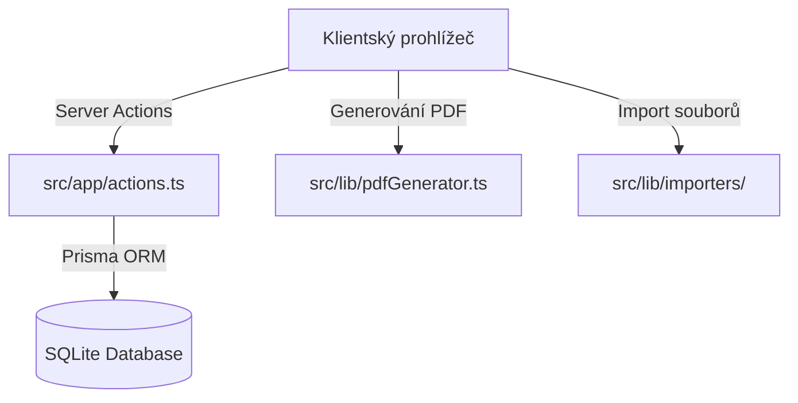

# Kompletní technická dokumentace – Generátor štítků

Tento dokument slouží jako komplexní průvodce architekturou, databázovým schématem, chováním jednotlivých modulů, API a rozšiřováním aplikace **Generátor štítků**.

---

## 1. Celkový přehled a adresářová struktura

Aplikace **Generátor štítků** je postavena jako monolitická webová aplikace v Next.js (App Router) v kombinaci se SQLite databází a Prisma ORM. Generování PDF souborů probíhá kompletně na straně klienta.



### Mapa adresářů projektu:

*   **[`prisma/`](file:///c:/Users/ferst/Desktop/Stitkovac/prisma)**
    *   [`schema.prisma`](file:///c:/Users/ferst/Desktop/Stitkovac/prisma/schema.prisma): Definuje databázové schéma SQLite a Prisma Clienta.
    *   `dev.db`: Lokální soubor SQLite databáze (generuje se automaticky při pushování schématu).
*   **[`public/`](file:///c:/Users/ferst/Desktop/Stitkovac/public)**
    *   `fonts/`: Obsahuje TrueType fonty `Roboto-Regular.ttf` a `Roboto-Bold.ttf` sloužící k podpoře české diakritiky v PDF.
*   **[`src/app/`](file:///c:/Users/ferst/Desktop/Stitkovac/src/app)**
    *   [`actions.ts`](file:///c:/Users/ferst/Desktop/Stitkovac/src/app/actions.ts): Všechny Server Actions (databázové operace, analýza importů, ověřování pravidel).
    *   [`layout.tsx`](file:///c:/Users/ferst/Desktop/Stitkovac/src/app/layout.tsx): Globální layout definující boční navigaci (`Sidebar`) a hlavní zónu obsahu.
    *   [`page.tsx`](file:///c:/Users/ferst/Desktop/Stitkovac/src/app/page.tsx): Stránka Dashboardu (statistika katalogu, historie posledních tisků a rychlý start).
    *   **[`import/`](file:///c:/Users/ferst/Desktop/Stitkovac/src/app/import)**
        *   [`ImportClient.tsx`](file:///c:/Users/ferst/Desktop/Stitkovac/src/app/import/ImportClient.tsx): Klientská logika pro 3-krokový import (nahrání $\rightarrow$ mapování sloupců $\rightarrow$ validace a zápis).
        *   [`page.tsx`](file:///c:/Users/ferst/Desktop/Stitkovac/src/app/import/page.tsx): Obalující serverová stránka importu.
    *   **[`login/`](file:///c:/Users/ferst/Desktop/Stitkovac/src/app/login)**
        *   [`page.tsx`](file:///c:/Users/ferst/Desktop/Stitkovac/src/app/login/page.tsx): Stránka přihlášení chránící aplikaci.
    *   **[`print/`](file:///c:/Users/ferst/Desktop/Stitkovac/src/app/print)**
        *   [`page.tsx`](file:///c:/Users/ferst/Desktop/Stitkovac/src/app/print/page.tsx): Stránka tisku štítků s mřížkou počáteční pozice, frontou a generátorem PDF.
    *   **[`products/`](file:///c:/Users/ferst/Desktop/Stitkovac/src/app/products)**
        *   [`ProductsClient.tsx`](file:///c:/Users/ferst/Desktop/Stitkovac/src/app/products/ProductsClient.tsx): Katalog produktů s filtry, řazením, vyhledáváním a rychlými editačními/mazacími modaly.
        *   [`page.tsx`](file:///c:/Users/ferst/Desktop/Stitkovac/src/app/products/page.tsx): Serverová stránka katalogu.
    *   **[`settings/`](file:///c:/Users/ferst/Desktop/Stitkovac/src/app/settings)**
        *   [`page.tsx`](file:///c:/Users/ferst/Desktop/Stitkovac/src/app/settings/page.tsx): Nastavení pravidel kontaktů (ContactRules), seedování demo dat, mazání DB a konfigurace integrace.
    *   **[`templates/`](file:///c:/Users/ferst/Desktop/Stitkovac/src/app/templates)**
        *   [`page.tsx`](file:///c:/Users/ferst/Desktop/Stitkovac/src/app/templates/page.tsx): Šablony etiket (zapínání/vypínání polí, kalibrace rozměrů a okrajů v mm).
*   **[`src/components/`](file:///c:/Users/ferst/Desktop/Stitkovac/src/components)**
    *   [`LabelPreview.tsx`](file:///c:/Users/ferst/Desktop/Stitkovac/src/components/LabelPreview.tsx): Komponenta vykreslující interaktivní HTML/CSS náhled jednoho štítku na základě šablony.
    *   [`Sidebar.tsx`](file:///c:/Users/ferst/Desktop/Stitkovac/src/components/Sidebar.tsx): Boční navigační lišta.
*   **[`src/lib/`](file:///c:/Users/ferst/Desktop/Stitkovac/src/lib)**
    *   [`db.ts`](file:///c:/Users/ferst/Desktop/Stitkovac/src/lib/db.ts): Inicializace Prisma Clienta (Singleton).
    *   [`pdfGenerator.ts`](file:///c:/Users/ferst/Desktop/Stitkovac/src/lib/pdfGenerator.ts): Hlavní renderovací algoritmus pro sestavení A4 tiskových PDF archů.
    *   **[`importers/`](file:///c:/Users/ferst/Desktop/Stitkovac/src/lib/importers)**
        *   [`ProductImporter.ts`](file:///c:/Users/ferst/Desktop/Stitkovac/src/lib/importers/ProductImporter.ts): TypeScript rozhraní pro importéry.
        *   [`CsvImporter.ts`](file:///c:/Users/ferst/Desktop/Stitkovac/src/lib/importers/CsvImporter.ts): Parser CSV souborů přes SheetJS.
        *   [`XlsxImporter.ts`](file:///c:/Users/ferst/Desktop/Stitkovac/src/lib/importers/XlsxImporter.ts): Parser Excel (`.xlsx`, `.xls`) souborů přes SheetJS.
        *   [`ShoptetApiImporter.ts`](file:///c:/Users/ferst/Desktop/Stitkovac/src/lib/importers/ShoptetApiImporter.ts): Příprava na synchronizaci dat přes e-shop API.
*   **[`src/middleware.ts`](file:///c:/Users/ferst/Desktop/Stitkovac/src/middleware.ts)**: Zabezpečení stránek (kontrola session cookie a přesměrování na `/login`).

---

## 2. Nastavení prostředí a autentizace

### 2.1. Soubor `.env`
V kořenovém adresáři se nachází `.env` s následujícími proměnnými:
*   `DATABASE_URL="file:./dev.db"`: Cesta k SQLite databázi.
*   `ADMIN_PASSWORD="vaše_heslo"`: Heslo pro přihlášení do administračního rozhraní aplikace.

### 2.2. Autentizační Middleware
Bezpečnost zajišťuje [`src/middleware.ts`](file:///c:/Users/ferst/Desktop/Stitkovac/src/middleware.ts).
1.  Při přístupu na jakoukoliv podstránku (vyjma `/login` a statických souborů) middleware zkontroluje existenci cookie `auth_session`.
2.  Pokud cookie chybí nebo je neplatná, uživatel je okamžitě přesměrován na `/login`.
3.  Přihlašovací formulář odesílá heslo na Server Action, která jej porovná s `ADMIN_PASSWORD`. Při úspěchu uloží session cookie se 7denní platností.

---

## 3. Podrobný popis databázového schématu (Prisma)

Aplikace pracuje se čtyřmi databázovými tabulkami:

### 3.1. `Product`
Reprezentuje záznam produktu. Každý produkt má unikátní kód (`sku`).
*   `id` (String, UUID, PK)
*   `sku` (String, unique) – Identifikátor produktu (např. SKU kód z e-shopu).
*   `name` (String) – Název produktu.
*   `brand` (String, nullable) – Značka výrobce.
*   `price` (Float, nullable) – Prodejní cena v Kč.
*   `safetyText` (String, nullable) – Bezpečnostní upozornění pro tisk (např. varování u kosmetiky).
*   `contactText` (String, nullable) – Kontaktní údaje distributora/výrobce.
*   `ean` (String, nullable) – EAN čárový kód.
*   `note` (String, nullable) – Interní administrativní poznámka.
*   `createdAt`, `updatedAt` (DateTime)

### 3.2. `LabelTemplate`
Konfigurace vzhledu a přesného tiskového rozložení štítků na archu A4.
*   `id` (String, UUID, PK)
*   `name` (String) – Název šablony (např. „Avery L7160“).
*   `fieldsConfig` (String, JSON) – Která pole se mají na štítku tisknout: `showName`, `showSku`, `showBrand`, `showPrice`, `showSafetyText`, `showContactText`, `showEan`.
*   `fontConfig` (String, JSON) – Velikosti písem v bodech: `nameFontSize`, `skuFontSize`, `brandFontSize`, `priceFontSize`, `bodyFontSize`.
*   `layoutConfig` (String, JSON) – Fyzické rozměry archu v mm:
    -   `leftMargin`: levý okraj papíru k prvnímu štítku.
    -   `topMargin`: horní okraj papíru k prvnímu štítku.
    -   `horizontalGap`: mezera mezi sloupci štítků.
    -   `verticalGap`: mezera mezi řádky štítků.
    -   `labelWidth`: šířka jedné etikety.
    -   `labelHeight`: výška jedné etikety.
    -   `labelRotation` (0 nebo 90): otočení obsahu.
    -   `dualLayout` (boolean): tisk dvou stejných polovin na jeden štítek.
    -   `sixIconsLayout` (boolean): rozdělení na mřížku 6 piktogramů.
*   `isDefault` (Boolean) – Výchozí šablona pro generátor.

### 3.3. `PrintJob`
Záznam o historii provedených tisků. Umožňuje jedním kliknutím znovu naplnit tiskovou frontu identickými daty.
*   `id` (String, UUID, PK)
*   `products` (String, JSON) – Pole vytištěných položek s počty kusů: `[{ productId, name, sku, price, quantity }]`.
*   `startPosition` (Int) – Počáteční pozice (1 až 21), na které tisk začal.
*   `createdAt` (DateTime)

### 3.4. `ContactRule`
Značková pravidla pro doplňování chybějících dat. Umožňuje automaticky přiřazovat kontakty a bezpečnostní upozornění na základě značky.
*   `id` (String, UUID, PK)
*   `brandPattern` (String) – Řetězec pro vyhledání značky (např. "InLei").
*   `companyName`, `ico`, `address`, `website` – Údaje distributora.
*   `safetyText` (String, nullable) – Bezpečnostní text pro tuto značku.
*   `isDefault` (Boolean) – Výchozí pravidlo aplikované na produkty bez specifické shody značky.

---

## 4. API Reference – Přehled Server Actions

Všechny databázové a analytické procesy jsou centralizovány v [`src/app/actions.ts`](file:///c:/Users/ferst/Desktop/Stitkovac/src/app/actions.ts):

| Název akce | Parametry | Návratová hodnota | Popis |
| :--- | :--- | :--- | :--- |
| `getProducts` | `search?: string` | `Promise<Product[]>` | Vyhledá produkty v DB podle názvu, SKU, značky nebo EAN. |
| `getProductById` | `id: string` | `Promise<Product \| null>` | Vrátí jeden produkt. |
| `createProduct` | `data: Omit<Product, 'id'>` | `Promise<{ success: boolean, error?: string }>` | Vytvoří produkt a automaticky aplikuje značková pravidla `ContactRule`. |
| `updateProduct` | `id: string, data: Partial<Product>` | `Promise<{ success: boolean, product?: Product, error?: string }>` | Aktualizuje produkt v DB. Přepíše nebo doplní kontakty na základě pravidel. |
| `deleteProduct` | `id: string` | `Promise<{ success: boolean }>` | Smaže produkt z katalogu. |
| `deleteProducts` | `ids: string[]` | `Promise<{ success: boolean }>` | Hromadně smaže pole produktů. |
| `analyzeImportedProducts` | `products: any[]` | `Promise<AnalysisReport>` | Analyzuje nahraná data z Excelu/CSV, spočítá nově vytvářené položky, aktualizace a odhalí případné chyby formátu. |
| `saveImportedProducts` | `products: any[], overwriteConfig?: any` | `Promise<{ success: boolean, importedCount: number, updatedCount: number }>` | Uloží importovaná data do DB (Upsert podle SKU) s možností volitelně omezit přepis stávajících polí. |
| `getTemplates` | *(žádné)* | `Promise<LabelTemplate[]>` | Načte šablony tisků. |
| `saveTemplate` | `id: string, data: Partial<LabelTemplate>` | `Promise<{ success: boolean }>` | Aktualizuje rozměry a konfiguraci šablony. |
| `savePrintJob` | `products: any[], startPosition: number` | `Promise<PrintJob>` | Uloží novou tiskovou úlohu do historie tisků. |
| `getPrintJobs` | *(žádné)* | `Promise<PrintJob[]>` | Načte historii tiskových úloh. |
| `getContactRules` | *(žádné)* | `Promise<ContactRule[]>` | Vrátí všechna značková pravidla. |
| `saveContactRule` | `id: string, data: any` | `Promise<{ success: boolean }>` | Vytvoří nebo aktualizuje pravidlo distributora. |
| `deleteContactRule` | `id: string` | `Promise<{ success: boolean }>` | Smaže pravidlo distributora. |

---

## 5. Matematika a kalibrace tisku (Generátor PDF)

Algoritmus v [`pdfGenerator.ts`](file:///c:/Users/ferst/Desktop/Stitkovac/src/lib/pdfGenerator.ts) provádí přepočet milimetrového rozvržení na DTP body používané formátem PDF.

### 5.1. Přepočet jednotek
PDF standard definuje 72 bodů (points) na jeden palec (inch). Jeden palec je přesně 25.4 milimetru. Přepočet je realizován vzorcem:
$$\text{body} = \text{milimetry} \times \frac{72}{25.4} \approx \text{milimetry} \times 2.83464567$$

### 5.2. Souřadnicový systém PDF
Na rozdíl od HTML, kde počátek `(0,0)` leží v levém horním rohu a souřadnice rostou směrem dolů, PDF standard umisťuje počátek `(0,0)` do **levého dolního rohu** stránky A4 (velikost A4 v bodech je $595.27 \times 841.89$ pt).

Při výpočtu pozice $Y$ pro daný řádek $r$ a sloupec $c$ štítku se postupuje takto:
1.  Určí se vzdálenost od horního okraje stránky v bodech:
    $$\text{offsetY}_{\text{top}} = \text{topMargin} + (r \times \text{labelHeight}) + (r \times \text{verticalGap})$$
2.  Přepočte se na souřadnice od spodního okraje:
    $$Y = 841.89 - \text{offsetY}_{\text{top}} - \text{labelHeight}$$
3.  Pozice $X$ od levého okraje se spočítá přímo:
    $$X = \text{leftMargin} + (c \times \text{labelWidth}) + (c \times \text{horizontalGap})$$

### 5.3. Registrace fontů a diakritiky
Pro správné vykreslení českých znaků (č, š, ž, ť...) se provádí registrace externích TrueType fontů:
```typescript
import fontkit from '@pdf-lib/fontkit';

// Registrace fontkitu do PDF dokumentu
const pdfDoc = await PDFDocument.create();
pdfDoc.registerFontkit(fontkit);

// Načtení a vložení souboru fontu (spuštěno na klientovi přes fetch)
const fontBytes = await fetch('/fonts/Roboto-Regular.ttf').then(res => res.arrayBuffer());
const robotoFont = await pdfDoc.embedFont(fontBytes);
```

---

## 6. Klientské funkce a chování UI

### 6.1. Vyhledávání produktů
Aplikace implementuje chování vyhledávání pro vysokou rychlost a úsporu výkonu:
*   **Minimální délka:** Vyhledávání v databázi se spustí až po zadání **3 a více znaků**. Při kratším řetězci se vyhledávání odloží.
*   **Debounce (200 ms):** Vyhledávací dotaz se odesílá až 200 ms po dokončení psaní, což zabraňuje zbytečnému přetěžování databáze při každém stisku klávesy.
*   **Tlačítko vymazání (X):** Kliknutím na křížek se okamžitě vymaže vyhledávací pole a zaktualizuje seznam produktů.

### 6.2. Filtrování kvality dat
V katalogu produktů jsou předpřipraveny čtyři rychlé filtry kvality, které filtrují produkty s chybějícími údaji:
*   `Chybí cena`: cena je `null` nebo $\le 0$.
*   `Chybí EAN`: EAN kód je prázdný.
*   `Chybí bezp. info`: bezpečnostní text je prázdný.
*   `Chybí kontakt`: kontaktní údaje jsou prázdné.
Filtry lze libovolně kombinovat (OR chování).

### 6.3. Speciální rozvržení (Dual, Rotace, 6 ikon)
V šablonách lze nastavit pokročilé transformace:
*   **Dual Layout (`isDual`):** Rozdělí etiketu na polovinu a vykreslí text dvakrát (vhodné pro přehýbací etikety).
*   **Rotace 90° (`labelRotation`):** Otočí souřadnicový systém vykreslení textů o 90 stupňů.
*   **Šablona 6 ikon (`sixIconsLayout`):** Namísto produktových dat rozdělí etiketu na 6 stejných polí (2 řady × 3 sloupce) a do každého vloží zvolený grafický symbol (např. recyklační znaky, výstražné piktogramy).

### 6.4. Export a import šablon (JSON)
V záhlaví editačního formuláře šablony v [`templates/page.tsx`](file:///c:/Users/ferst/Desktop/Stitkovac/src/app/templates/page.tsx) jsou k dispozici tlačítka pro stahování a nahrávání nastavení:
*   **Export konfigurace:** Stáhne aktuální konfiguraci polí, fontů a layoutu jako JSON soubor.
*   **Import konfigurace:** Nahraje JSON soubor do editoru, čímž okamžitě přepíše hodnoty formuláře a zaktualizuje živý náhled štítku. Uživatel může konfiguraci dále upravit a kliknutím na "Uložit šablonu" ji zapsat do databáze.

---

## 7. Vývojářský návod

### 7.1. Přidání vlastního importéru
Chcete-li přidat nový zdroj produktů (např. XML feed nebo jiné API), vytvořte novou třídu v [`src/lib/importers/`](file:///c:/Users/ferst/Desktop/Stitkovac/src/lib/importers/) implementující rozhraní `ProductImporter`:

```typescript
import { ProductImporter, ImportResult } from './ProductImporter';

export class MujNovyImporter implements ProductImporter {
  name = 'Můj nový zdroj';

  async parse(file: File): Promise<ImportResult> {
    // 1. Zpracování souboru/dat
    // 2. Namapování na standardní strukturu řádků
    return {
      headers: ['Kód', 'Název produktu', 'Cena'],
      rows: [
        { 'Kód': 'SKU-01', 'Název produktu': 'Položka 1', 'Cena': '99' }
      ],
      success: true
    };
  }
}
```

### 7.2. Odstraňování tiskových chyb (Troubleshooting)
*   **Štítky nesedí na fyzický papír (posunují se s každým dalším řádkem dolů/nahoru):**
    Zkontrolujte nastavení tisku v prohlížeči. Ovladač tiskárny nesmí mít zvoleno *Přizpůsobit stránce* (Fit to page), nýbrž **Skutečná velikost / Měřítko 100%**. Přizpůsobení změní velikost A4 archu a rozhodí milimetrové rozvržení.
*   **Znaky s diakritikou se nahrazují otazníky nebo čtverečky:**
    Ujistěte se, že se správně načítají Roboto fonty ze složky `/public/fonts/`. Pokud dojde k selhání fetch požadavku, generátor spadne zpět na písmo Helvetica, které českou diakritiku nepodporuje.
