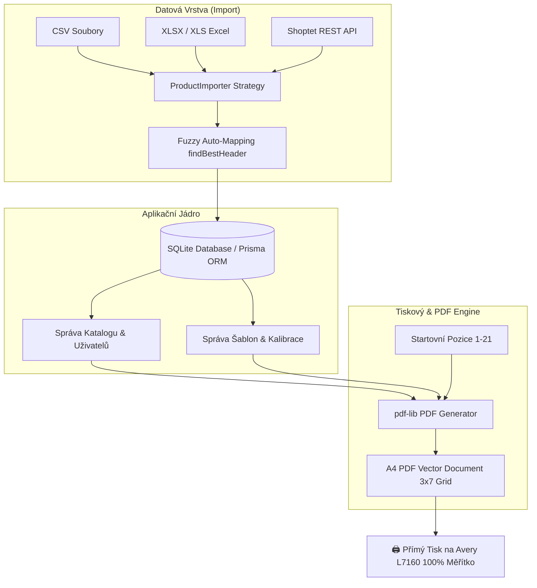

<div align="center">

# 🏷️ Štítkovač – Generátor a Tisk Produktových Etiket

**Moderní fullstack webová aplikace pro e-shopy zaměřená na správy produktových dat, šablonování a přesný tisk etiket na A4 archy (3 sloupce × 7 řad / Avery L7160).**

[](https://nextjs.org/)
[](https://react.dev/)
[](https://www.typescriptlang.org/)
[](https://tailwindcss.com/)
[](https://www.prisma.io/)
[](https://vitest.dev/)
[](https://github.com/Matyharo/stitkovac/actions)
[](LICENSE)

</div>

---

## 🎯 O Projektu & Přínos pro E-commerce

Aplikace **Štítkovač** řeší reálný každodenní problém e-commerce obchodníků: **rychlou, přesnou a bezchybnou přípravu a tisk produktových etiket přímo ze skladových či produktových databází.**

Tradiční nástroje pro tisk etiket často trpí nepřesným posunem tiskárny na papíře, plýtváním napůl spotřebovaných tiskových archů nebo komplikovaným importem z Excelu. Štítkovač tento proces automatizuje a přináší:

- 🖨️ **Milimetrovou kalibraci tisku** pro standardizované tiskové etikety (Avery L7160, 63,5 × 38,1 mm).
- ♻️ **Tisk od libovolné pozice (1–21):** Umožňuje využít i napůl spotřebovaný arch A4 bez plýtvání etiketami.
- 🧠 **Chytrý import z Excelu/CSV:** Automatické heuristické párování sloupců (SKU, název, cena, značka, EAN).
- 🔐 **Multi-user přístup a auditní logování:** Bezpečný přihlašovací systém s rolí administrátora a sledováním uživatelských akcí.
- 🔌 **Modulární architekturu (Pattern Importer):** Připravenost pro přímou synchronizaci produktů přes API (Shoptet API).

---

## 🛠️ Technologický Stoh (Tech Stack)

| Vrstva | Technologie | Popis & Využití |
| :--- | :--- | :--- |
| **Frontend Framework** | **Next.js 16 (App Router)** | React 19, Server Actions, klientský rendering náhledů |
| **Jazyk** | **TypeScript 5** | Striktní typová kontrola napříč celou aplikací |
| **Styling & UI** | **Tailwind CSS v4 & Lucide Icons** | Moderní responsive design system s micro-animacemi |
| **PDF Engine** | **pdf-lib & fontkit** | Vykreslování vektorového PDF na straně klienta s podporou české diakritiky (Roboto TTF) |
| **Databáze & ORM** | **Prisma ORM & SQLite** | Lokální relační databáze s rychlou odezvou |
| **Datový Import** | **SheetJS (xlsx)** | Parsování `.csv`, `.xlsx` a `.xls` souborů |
| **Testování & CI/CD** | **Vitest & GitHub Actions** | Automatizovaný ucelený pipeline (lint, tsc, tests, build) |

## 🌟 Klíčové Funkce & Architektura



### 1. 🖨️ Generátor PDF & Tiskový Layout (`src/lib/pdfGenerator.ts`)
- Vektorové generování PDF dokumentů v reálném čase s přesností na bod (`pt` / `mm`).
- Možnost zapnutí **Duálního layoutu** (dva menší štítky na jedné etikety) nebo **Grid layoutu - 6 ikon**.
- Uživatelská nastavení offsetů (`horní margin`, `levý margin`, `mezeru mezi etiketami`).

### 2. 📊 Chytrý Importér s Heuristikou (`src/lib/importers/`)
- Rozhraní `ProductImporter` využívá návrhový vzor **Strategy**:
  - `CsvImporter`: Zpracování CSV souborů s automatickou detekcí kódování UTF-8.
  - `XlsxImporter`: Parsování více-listových sešitů Excel.
  - `ShoptetApiImporter`: Připravené rozhraní pro napojení e-shopového API.
- **Fuzzy Auto-mapping (`findBestHeader`):** Systém automaticky detekuje sloupce typu `Kód`, `SKU`, `Cena`, `Značka` či `Bezpečnostní text`.

### 3. 🔐 Bezpečnost, Audit Trail & Multi-User
- Bezpečné hashování hesel uživatelů.
- Správa uživatelských profilů a oprávnění v sekci Nastavení.
- Reálný **Auditní log (`src/app/logs`)** zaznamenávající všechny kritické akce (importy, změny šablon, mazání produktů).

---

## 🚀 Rychlý Start (Instalace a Spuštění)

### Požadavky
- **Node.js**: `v20.x` nebo novější
- **npm**: `v10.x` nebo novější

### 1. Klonování repozitáře
```bash
git clone https://github.com/Matyharo/stitkovac.git
cd stitkovac
```

### 2. Instalace závislostí
```bash
npm install
```

### 3. Příprava a naplnění databáze (Seeding)
Vytvořte SQLite databázi, pusťte migrace a nahrajte testovací data:
```bash
npx prisma db push
npx prisma db seed
```

### 4. Spuštění vývojového serveru
```bash
npm run dev
```
Aplikace poběží na adrese: [http://localhost:3000](http://localhost:3000).

---

## 🧪 Testování a Kontrola Kvality

Kódová základna dodržuje striktní standardy kvality. Spusťte testy a kontroly pomocí následujících příkazů:

```bash
# Spuštění unit testů (Vitest)
npm test

# Kontrola TypeScript typů
npx tsc --noEmit

# Spuštění ESLint linteru
npm run lint

# Produkční build aplikace
npm run build
```

---

## 🏛️ CI/CD Workflow

V repozitáři je nastaven **GitHub Actions CI Pipeline** (`.github/workflows/ci.yml`), který při každém `push` a `pull-requestu` automaticky provádí:
1. Kontrolu závislostí a generování Prisma klienta
2. TypeScript kontrolu (`tsc`)
3. Static Code Analysis (`eslint`)
4. Spuštění sady Unit Testů (`vitest`)
5. Produkční build (`next build`)

---

## 📖 Kompletní Vývojářská Dokumentace

Podrobný technický popis schématu databáze, výpočtu tiskových matic a návod na rozšíření importérů naleznete v souboru [DOCUMENTATION.md](DOCUMENTATION.md).

---

## 👤 Autor

**Ing. Matouš Ferstl**
- **GitHub:** [@Matyharo](https://github.com/Matyharo)
- **Projekt:** [Repozitář Štítkovač](https://github.com/Matyharo/stitkovac)

---

## 📄 Licence

Tento projekt je licencován pod licencí MIT - podrobnosti naleznete v souboru [LICENSE](LICENSE).
