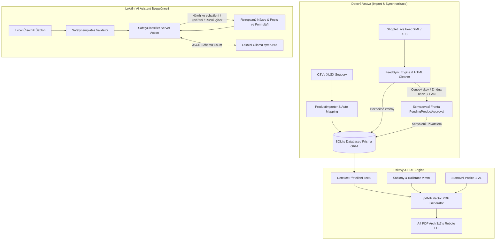

<div align="center">

# 🏷️ Štítkovač – Generátor a Tisk Produktových Etiket

**Moderní fullstack webová aplikace pro e-shopy zaměřená na správu produktových dat, automatickou synchronizaci Shoptet feedu, lokálního AI asistenta pro bezpečnostní texty a milimetrově přesný tisk etiket na A4 archy (3 sloupce × 7 řad / Avery L7160).**

[](https://nextjs.org/)
[](https://react.dev/)
[](https://www.typescriptlang.org/)
[](https://tailwindcss.com/)
[](https://www.prisma.io/)
[-000000?style=for-the-badge)](https://ollama.com/)
[](https://vitest.dev/)
[](https://github.com/Matyharo/stitkovac/actions)
[](LICENSE)

</div>

---

## 🎯 O Projektu & Přínos pro E-commerce

Aplikace **Štítkovač** řeší každodenní potřebu e-commerce obchodníků a salonních distributorů: **rychlou, přesnou a bezchybnou přípravu a tisk produktových etiket s povinnými bezpečnostními a kontaktními údaji přímo ze skladové a e-shopové databáze.**

Tradiční nástroje pro tisk etiket často trpí nepřesným posunem tiskárny na papíře, plýtváním napůl spotřebovanými tiskovými archy, tichým ořezem dlouhých textů nebo zdlouhavým ručním dohledáváním povinných bezpečnostních textů. Štítkovač tento proces automatizuje a přináší:

- 🤖 **Lokálního AI asistenta pro bezpečnostní texty (Ollama):** Klasifikuje produkt podle názvu a popisu pomocí lokálního modelu (`qwen3:4b`) a přiřadí přesné, schválené české znění z udržovaného Excel číselníku – včetně možnosti ručního výběru kategorie.
- 🔄 **Automatickou synchronizaci Shoptet Live Feedu se schvalováním anomálií:** Pravidelně či na kliknutí stahuje XML/XLSX export ze Shoptetu, automaticky propisuje bezpečné změny a podezřelé odchylky (cenové skoky, výrazné změny názvu, neplatné EAN kódy) řadí do schvalovací fronty.
- 🖨️ **Milimetrovou kalibraci tisku a hlídání přetečení textu:** Přesné generování pro archy Avery L7160 (63,5 × 38,1 mm) s automatickou kontrolou před exportem, která upozorní na konkrétní SKU, u nichž by se dlouhý bezpečnostní text do zvolené šablony nevešel.
- ♻️ **Tisk od libovolné pozice (1–21):** Umožňuje využít i částečně spotřebovaný arch A4 bez plýtvání samolepkami.
- 🧠 **Chytrý import z Excelu/CSV s živou ukázkou mapování:** Automatické párování sloupců (SKU, název, popis, cena, značka, EAN, bezpečnostní text, kontakt) s ukázkou dat z 1. řádku a detailním diff náhledem změn.
- 🔐 **Multi-user přístup, zálohování a auditní logování:** Přihlašovací systém s rolí administrátora, kompletní historií aktivit a jedním kliknutím stahovatelnou zálohou databáze či XLSX katalogu.

---

## 🛠️ Technologický Stoh (Tech Stack)

| Vrstva | Technologie | Popis & Využití |
| :--- | :--- | :--- |
| **Frontend Framework** | **Next.js 16 (App Router)** | React 19, Server Actions, klientský rendering náhledů |
| **Jazyk** | **TypeScript 5** | Striktní typová kontrola napříč celou aplikací |
| **Styling & UI** | **Tailwind CSS v4 & Lucide Icons** | Moderní responzivní design systém |
| **Lokální AI Klasifikace** | **Ollama (`qwen3:4b`)** | Lokální LLM volané ze serveru se strukturovaným JSON schématem |
| **PDF Engine** | **pdf-lib & fontkit** | Vektorové PDF na straně klienta s podporou české diakritiky (Roboto TTF) a měřením přetečení |
| **Databáze & ORM** | **Prisma ORM & SQLite** | Lokální relační databáze s rychlou odezvou |
| **Datový Import & Číselníky** | **SheetJS (`xlsx`)** | Parsování `.csv`, `.xlsx`, `.xls`, Shoptet XML/XLS feedů a číselníku bezpečnostních šablon |
| **Testování & CI/CD** | **Vitest & GitHub Actions** | Automatizovaná pipeline (`prisma generate`, `lint`, `tsc`, `vitest`, `next build`) |

---

## 🌟 Klíčové Funkce & Architektura



### 1. 🤖 Lokální AI Asistent pro bezpečnostní texty (`src/lib/safetyClassifier.ts`, `src/lib/safetyTemplates.ts`)
- **Jediný zdroj pravdy v Excelu:** Všechny kategorie, vodítka, režimy a přesná česká znění bezpečnostních textů se načítají a validují ze souboru `data/safety/Depilujeme_bezpecnostni_texty.xlsx` (listy `Šablony` a `Použití`).
- **Bezpečná lokální klasifikace:** Serverová akce pošle rozepsaný název a očištěný prostý text popisu produktu do lokální Ollamy (`POST /api/chat`, výchozí model `qwen3:4b`) s vynuceným JSON schématem povolených kódů. Model nikdy nevymýšlí vlastní text etikety.
- **Režimy kategorií a ruční výběr:**
  - *Návrh ke schválení*: Zobrazí přesný návrh textu (včetně porovnání se stávajícím textem ve formuláři) a umožní jeho převzetí tlačítkem **Použít návrh**.
  - *Ověřit konkrétní výrobek*: Zobrazí upozornění **Co zkontrolovat** a před převzetím vyžaduje potvrzení zaškrtávacím políčkem.
  - *Ruční posouzení / Přeskočit*: Automaticky nic nevkládá; pokud si AI není jistá (`NEURCENO`), může uživatel přímo v kartě vybrat kategorii ručně z rozbalovacího seznamu všech šablon.

### 2. 🔄 Automatický Shoptet Live Feed & Schvalovací fronta (`src/lib/feedSync.ts`)
- Automaticky rozpozná XML i XLS/XLSX export ze Shoptetu, očistí popisy produktů od vložených skriptů, stylů a e-shopových widgetů a převede je na čitelný text s odrážkami.
- **Detekce anomálií:** Běžné aktualizace (např. doplnění popisu nebo drobná úprava ceny) se zapíší automaticky. Položky s cenovým skokem nad nastavený práh (výchozí 30 %), výraznou změnou názvu nebo neplatným EAN kódem jdou do **Položek čekajících na schválení**, kde je lze jednotlivě upravit, schválit či zamítnout.
- **Ochrana souběhu:** Schválení starší položky ve frontě nikdy nepozorovaně nepřepíše novější ručně upravený bezpečnostní text v katalogu.

### 3. 🖨️ Generátor PDF & Kontrola přetečení (`src/lib/pdfGenerator.ts`)
- Vektorové generování PDF dokumentů na straně klienta s vloženým písmem **Roboto** (plná podpora české diakritiky).
- **Pre-export detekce přetečení (`detectSafetyTextOverflows`):** Před vygenerováním PDF změří reálné zalomení řádků podle zvolené velikosti písma a rozměrů šablony. Pokud by se některý bezpečnostní text na etiketu nevešel, zobrazí se seznam dotčených SKU s přímým odkazem na úpravu šablony.

---

## 🚀 Rychlý Start (Instalace a Spuštění)

### Požadavky
- **Node.js**: `v20.x` nebo novější
- **npm**: `v10.x` nebo novější
- **Ollama** *(volitelné, pro AI návrhy bezpečnostních textů)*: [ollama.com](https://ollama.com/) s modelem `qwen3:4b` (`ollama pull qwen3:4b`)

### 1. Klonování repozitáře a instalace závislostí
```bash
git clone https://github.com/Matyharo/stitkovac.git
cd stitkovac
npm install
```

### 2. Konfigurace prostředí (`.env`)
Zkopírujte vzorový soubor `.env.example` do `.env` a případně upravte přihlašovací údaje, URL vašeho Shoptet feedu nebo adresu Ollamy:
```bash
cp .env.example .env
```

### 3. Příprava databáze
```bash
npx prisma generate
npx prisma db push
```
*(Pro naplnění prázdné databáze ukázkovými daty můžete spustit `npx prisma db seed`.)*

### 4. Spuštění vývojového serveru
```bash
npm run dev
```
Aplikace poběží na adrese [http://localhost:3000](http://localhost:3000).

---

## 🧪 Testování a Kontrola Kvality

```bash
# Spuštění unit testů (Vitest – běží kompletně offline bez nutnosti spuštěné Ollamy)
npm test

# Spuštění živých integračních testů proti lokální Ollamě (vyžaduje běžící ollama serve + qwen3:4b)
# PowerShell:
$env:RUN_LIVE_OLLAMA_TESTS="1"; npx vitest run src/lib/__tests__/safetyLiveOllama.test.ts

# Kontrola TypeScript typů
npx tsc --noEmit

# Spuštění ESLint linteru
npm run lint

# Produkční build aplikace
npm run build
```

---

## 📖 Kompletní Vývojářská Dokumentace

Podrobný technický popis databázového schématu, správy Excel číselníku pro AI asistenta, synchronizace Shoptet feedu a výpočtu tiskových matic naleznete v souboru [DOCUMENTATION.md](DOCUMENTATION.md).

---

## 👤 Autor

**Ing. Matouš Ferstl**
- **GitHub:** [@Matyharo](https://github.com/Matyharo)
- **Projekt:** [Repozitář Štítkovač](https://github.com/Matyharo/stitkovac)

---

## 📄 Licence

Tento projekt je licencován pod licencí MIT – podrobnosti naleznete v souboru [LICENSE](LICENSE).
